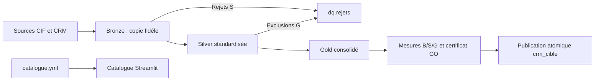

# TD Gouvernance, profilage et qualité des données : dépôt de groupe

Ce dépôt est le vôtre pour tout le TD (5 séances). Il contient la pile Docker, vos fichiers de travail et les **livrables à remplir à chaque séance**. L'enseignant a un accès en lecture : il lit votre avancement ici, entre les séances.

## Démarrer (une fois, séance 1)

1. Créez votre dépôt à partir du modèle (bouton « Use this template », dépôt **public dès sa création**), nommé `td-qualite-GROUPE` (par exemple `td-qualite-g03`).
2. Ajoutez chaque membre du groupe en écriture ; le professeur consulte le dépôt public sans invitation.
3. Clonez le dépôt, puis déposez le dossier `data/` fourni par l'enseignant à la racine du clone. Il est ignoré par git : ne le commitez jamais.
4. Lancez la pile : `docker compose up -d --build`, puis `docker exec dq_jupyter python pipelines/load_sources.py`.
5. Renseignez `livrables/00_equipe.md` avant la fin de l'ouverture de S1.

## Ce que vous rendez, séance par séance

| Séance | Livrable | Étiquette (tag) à poser à la fin |
|---|---|---|
| S1 | `livrables/S1_bronze_profilage.md` | `seance-1` |
| S2 | `livrables/S2_regles_great_expectations.md` | `seance-2` |
| S3 | `livrables/S3_integrite_soda.md` | `seance-3` |
| S4 | `livrables/S4_silver_gold.md` | `seance-4` |
| S5 | `livrables/S5_certificat_publication.md` | `seance-5` |
| Après S5 | `livrables/DOSSIER_GO_NOGO.md` | `rendu-final` |

Le modèle PowerPoint `livrables/Livrable_Groupe_TD_AssurConnect.pptx` reprend l'ensemble de ces livrables dans un seul fichier chartré (encadrés ambre « Attendu », zones à compléter). L'enseignant précise si le livrable noté est ce fichier ou les fichiers `.md` ; dans tous les cas, les chiffres viennent de vos mesures et les preuves du dépôt.

Deux fichiers vivent toute la durée du TD : `AVANCEMENT.md` (une ligne par story : statut et preuve) et `livrables/JOURNAL_DECISIONS.md` (chaque seuil, sévérité ou règle de survie choisi, avec le rôle qui l'a décidé).

## Comment remplir un livrable

Un livrable ne raconte pas ce que vous avez fait : il **prouve** ce que vous avez mesuré. Pour chaque constat :

1. **un chiffre mesuré**, avec la règle (RQ-xxx) et la couche (source, bronze, silver, gold) ;
2. **la preuve** : le fichier, la requête ou la commande qui reproduit ce chiffre, par un chemin du dépôt ;
3. **ce que cela change** : une conséquence ou une décision, attribuée à un rôle (Data Owner, Data Steward, ingénieur qualité).

Les emplacements à compléter sont marqués `[À COMPLÉTER]` ou `…`. Un livrable terminé n'en contient plus ; un livrable inachevé garde ses marqueurs, ce qui est normal et visible : ne les effacez pas pour faire propre.

Ne copiez pas les valeurs d'un autre groupe ni celles d'un tutoriel : l'enseignant compare vos chiffres à ceux d'une exécution de référence, et un écart expliqué vaut mieux qu'un chiffre juste sans preuve.

## Règles du dépôt

- **Un commit par morceau de travail**, par la personne qui l'a fait, avec un message de la forme `S2: RQ-003 nul, vide et blanc séparés (US-10)`. L'historique atteste la contribution de chacun.
- **À la fin de chaque séance** : commit, `git tag seance-N`, `git push --tags`. Vous pouvez compléter ensuite ; l'étiquette fixe l'état rendu en séance.
- Ne réécrivez jamais l'historique (`push --force`, `rebase` d'un commit déjà poussé).
- Ne commitez pas : `data/`, les sauvegardes SQL, les fichiers `.env`, les dossiers `uncommitted` de Great Expectations. Le `.gitignore` en exclut déjà la plupart ; la vérification automatique échoue si un fichier interdit passe.
- Notebooks : commitez-les avec leurs sorties, sans y laisser plus de vingt lignes de données brutes.
- Une modification de silver, de gold ou d'un fichier de checks se fait dans le code et se relance : on ne corrige jamais une couche à la main.

## Vérification automatique

À chaque `push`, un contrôle (`scripts/controle_livrable.py`, onglet Actions) affiche l'avancement de chaque livrable (marqueurs restants) et **échoue uniquement** si un fichier interdit est présent. Pour le lancer chez vous : `python3 scripts/controle_livrable.py`.

## Si vous êtes bloqués

La règle des vingt minutes : au-delà, appelez l'enseignant. Pour repartir d'un état propre de la base, l'enseignant peut utiliser un point de reprise ; vos fichiers (notebooks, checks, livrables) ne sont jamais touchés. Notez la reprise utilisée dans la section « Difficultés » du livrable de la séance.


## Rendu consolidé et corrections du 15 novembre 2026

Le livrable de groupe rempli est `livrables/Livrable_Groupe_TD_AssurConnect.pptx` ; les Markdown de séance fournissent également les chiffres, populations et liens de preuve à jour. Le dossier de décision court est `livrables/Dossier_GO_NO_GO_AssurConnect_G02_corrige.pdf`. Le support de soutenance synchronisé est `livrables/Soutenance_AssurConnect_G02.pptx`.

Sur un ancien volume où reader ne peut pas lire Bronze, appliquer `sql/migrations/20261115_reader_bronze.sql` avec un compte administrateur. Ce script accorde uniquement SELECT et ne change aucune donnée. Les lectures source/Bronze utilisent reader ; l’historisation utilise une connexion d’écriture distincte.

### Rejouer sans altérer le lot déjà certifié

- S1 US-09 : `notebooks/US-09_client_actif.ipynb`, lot `DQ_BATCH`, date `DQ_REFERENCE_DATE`, lecture seule.
- S2 : exécuter US-10, US-11 puis S2_g02 ; sorties GE sous `reports/ge/gx/expectations/`, CSV sous `livrables/preuves/`. `DQ_COMPARISON_DATE` fixe la date de comparaison pour reproduire une exécution. Utiliser `DQ_HISTORY_SCHEMA` pour valider en schéma isolé ; modifier l’historique nominal après certification périme son empreinte.
- S4 : ne pas reconstruire le lot nominal déjà certifié pour une simple vérification. Les rapports conservent la construction et le rejeu historiques. Le nettoyage sur exception est testé séparément.
- S5 : `notebooks/S5_g02.ipynb` reconnaît le contenu déjà publié et le vérifie sans rechargement ; nouvelles traces sous `reports/executions/`. Le Steward vérifie les empreintes, et non seulement les volumes.

Vérifications : `python3 scripts/controle_livrable.py`, `python3 scripts/verifier_syntaxe.py`, `python -m unittest discover -s tests -v` et `pipelines/s5_controles_tests.run_tests()`. Les dépendances des tests sont épinglées dans le job CI : pandas, SQLAlchemy, PyYAML, nbformat, nbclient, Streamlit (tests de l’interface), Great Expectations et NumPy (rejeu réel des règles). Les tests d’intégration S4/S5 nécessitent MariaDB et créent uniquement leurs propres schémas `s5_test_*`. Les résultats d’exécution se trouvent dans `reports/AUDIT_validation.json`.

Les prérequis demandent un dépôt public dès sa création et un tag final `rendu-final`. Les corrections sont enregistrées dans la branche locale `main` et le tag local `rendu-final`. Le groupe a choisi de pousser lui-même ces références ; aucun push n’a été réalisé ici (authentification GitHub absente du terminal). Vérification des références : `git ls-remote origin refs/heads/main refs/tags/rendu-final refs/tags/rendu-final^{}`. Les jalons historiques absents ne sont pas recréés. La transmission de l’URL au professeur reste à la charge du groupe.

Validation reproductible dans le conteneur :

```bash
python scripts/valider_notebooks.py --date-comparaison 2026-11-15
```

Ce script est à lancer depuis une copie du dépôt accessible au conteneur (incluant `scripts/`, `notebooks/`, `pipelines/` et les preuves). Il prépare automatiquement l’historique S2 isolé, exécute les six notebooks dans l’ordre, conserve les sorties réussies et nettoie son schéma même en cas d’échec. Une annotation humaine existante dans l’échantillon US-11 provoque un refus de remplacement ; le script ne l’efface pas. Les suites GE valident la colonne calculée `conforme` ; leurs prédicats métier et paramètres restent dans US-10.

### Compléments de conformité professeur — 15/11/2026

Les contrôles Soda Bronze `soda/checks/bronze_*_checks.yml` filtrent toutes les relations par lot ; les fichiers sans préfixe restent le diagnostic CRM. Résultats et populations RQ-005 : [livrable S3](livrables/S3_integrite_soda.md). US14 autonome : `queries/S3_US14_client_actif.sql` (lot et date explicites). S3 rejoué sur copie : vingt lignes métier au total. Ligne SQL réelle du certificat : `livrables/preuves/S5_certificat_ligne_sql.json` ; démonstration US30 synthétique exécutée séparément du lot certifié.

La rotation S4/S5 reste incomplète et nécessite la validation du professeur. Répétition orale non attestée ; jalons historiques manquants non recréés. Références locales prêtes à pousser par le groupe : `main` et `rendu-final` ; aucune transmission au professeur revendiquée.

### Architecture et points d’entrée

`initdb/` initialise les schémas et le catalogue de règles. `pipelines/` contient les adaptateurs et les moteurs de contrôle, de résolution RQ-019 et de publication. `sql/` porte la décision du certificat et les migrations de droits ; `queries/` la requête autonome US14 ; `soda/` les checks et leur exécuteur. `scripts/` regroupe les validations isolées et contrôles du dépôt. `reports/` conserve les mesures et preuves, `livrables/` les décisions et rendus, `catalogue/` les métadonnées et leur interface.

Points d’entrée : `pipelines/load_sources.py` prépare les sources ; `notebooks/S1_g02.ipynb` ingère Bronze ; `notebooks/S2_US10_regles_en_tests.ipynb` porte GE ; `notebooks/S3_g02.ipynb` le diagnostic d’intégrité ; `notebooks/S4_g02.ipynb` construit les tables Silver/Gold opérationnelles ; `notebooks/S5_g02.ipynb` appelle le moteur de certification/publication. `S4_silver.ipynb` et `S4_gold.ipynb` conservent les étapes historiques. Une vérification du lot certifié utilise les relectures S5 et les fixtures isolées, sans reconstruire ses couches.



US10 est le point d’entrée GE Bronze/Silver/Gold : huit couples règle/table, sept RQ, historique temporaire et connexions de lecture/écriture distinctes. Depuis une copie du dépôt :

```bash
python scripts/valider_notebooks.py --notebooks S2_US10_regles_en_tests --date-comparaison 2026-11-15
python scripts/valider_notebooks.py --silver --date-comparaison 2026-11-15
python scripts/valider_notebooks.py --gold --date-comparaison 2026-11-15
streamlit run catalogue/app.py --server.address 0.0.0.0 --server.port 8502
```

Bronze utilise `reader` ; Silver/Gold utilisent la connexion autorisée `root` de l’environnement pédagogique, sans écriture métier. `DQ_DATABASE_URL` configure exclusivement la lecture ; `DQ_WRITE_DATABASE_URL` l’historisation. Gold utilise `client_unique`/`contrat_certifie`, les statuts S5 et l’âge à la souscription : PM exclues, références/natures/dates absentes en échec. La commande `--gold` régénère `reports/S2_execution_gold.json` après réussite et nettoyage du schéma temporaire. Les suites et rapports restent séparés par couche ; Silver/Gold ne remplacent pas les sorties Bronze du notebook.

Le catalogue Streamlit lit directement les cinq fiches de `catalogue/catalogue.yml`, résout Owner/Steward et expose définitions, RQ et lineage sans accès DB. Aucun export JSON ni service Docker supplémentaire n’est requis ; utiliser le montage et le port 8502 existants. Tests UI : `python -m unittest discover -s tests -p test_catalogue.py -v`.
