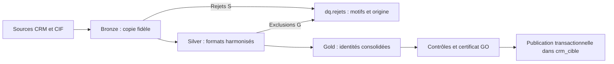

# AssurConnect — Qualité des données et préparation de la migration CRM

Groupe G02 : Iliana, Maria Camila, Firdaouss et Ruth.

Le projet prépare les données clients, contrats et sinistres d’AssurConnect pour leur publication dans un CRM cible. Nous réunissons les sources CRM et CIF, mesurons leurs défauts, préparons les données et vérifions ce qui peut être publié. Chaque transformation reste reliée à son origine.

## Résultat

Pour le lot `L-2026-10-01`, notre recommandation est un **GO sous conditions pour le périmètre certifié**, publié le 12/11/2026 avec l’approbation de Ruth, Data Owner.

| Données publiées | Gold | CRM cible | Écart |
|---|---:|---:|---:|
| Clients | 120 673 | 120 673 | 0 |
| Contrats | 95 822 | 95 822 | 0 |
| Sinistres | 88 824 | 88 824 | 0 |

Les empreintes correspondent également sur les trois tables. Le certificat `S5-d7c760617b538e9240c8541a4f7` couvre **59 contrôles bloquants conformes sur 59 attendus**, pour 18 règles sur Bronze, Silver et Gold. RQ-025 vérifie séparément la publication.

Le GO ne couvre pas toutes les données reçues : 377 identités restent exclues, 23 consolidations restent à confirmer humainement, 1 569 statuts sont `A_REVOIR` et 5 190 téléphones sont absents sur la population Gold contrôlée. Le [dossier de décision](livrables/DOSSIER_GO_NOGO.md) détaille ces réserves et leur suivi.

## Parcours des données



Bronze conserve les valeurs reçues. Silver harmonise les formats et isole les rejets. Gold construit les identités de référence et les relations retenues. La publication exige un certificat valide lié au contenu Gold ; le chargement et la réconciliation sont réalisés dans une transaction.

Le Data Owner valide les conventions et le périmètre, le Data Steward instruit les écarts, et l’ingénieure qualité met en œuvre les traitements et contrôles. Les [rôles et contributions](livrables/00_equipe.md) sont détaillés par séance.

## Livrables

| Sujet | Document |
|---|---|
| Sources, Bronze et profilage | [S1](livrables/S1_bronze_profilage.md) |
| Règles et tests Great Expectations | [S2](livrables/S2_regles_great_expectations.md) |
| Intégrité et contrôles Soda | [S3](livrables/S3_integrite_soda.md) |
| Silver, Gold et traçabilité | [S4](livrables/S4_silver_gold.md) |
| Certificat et publication | [S5](livrables/S5_certificat_publication.md) |
| Décisions et seuils | [Journal des décisions](livrables/JOURNAL_DECISIONS.md) |
| Suivi par story | [Avancement](AVANCEMENT.md) |
| Décision de migration | [Dossier Markdown](livrables/DOSSIER_GO_NOGO.md) et [PDF](livrables/Dossier_GO_NO_GO_AssurConnect_G02.pdf) |
| Présentation complète | [Livrable de groupe](livrables/Livrable_Groupe_TD_AssurConnect.pptx) |
| Support oral | [Soutenance](livrables/Soutenance_AssurConnect_G02.pptx) |

## Démarrage

Docker et Docker Compose sont nécessaires. Le dossier de données `data/` doit être présent à la racine ; il n’est pas versionné. Les identifiants de la configuration Docker sont destinés à un environnement local de développement.

```bash
docker compose up -d --build
docker exec dq_jupyter python pipelines/load_sources.py
```

JupyterLab est accessible sur `http://localhost:8888/lab?token=assurconnect`. L’initialisation des schémas est dans `initdb/` et s’applique lors de la création du volume MariaDB.

| Étape | Point d’entrée |
|---|---|
| Chargement des sources | `pipelines/load_sources.py` |
| Ingestion et contrôles Bronze | `notebooks/S1_g02.ipynb` |
| Règles GE | `notebooks/S2_US10_regles_en_tests.ipynb` |
| Diagnostic d’intégrité | `notebooks/S3_g02.ipynb` |
| Construction Silver et Gold | `notebooks/S4_g02.ipynb` |
| Certificat et publication | `notebooks/S5_g02.ipynb` |
| Définition du client actif | `queries/S3_US14_client_actif.sql` |

Les notebooks `S4_silver.ipynb` et `S4_gold.ipynb` détaillent les étapes de construction. Le notebook intégré `S4_g02.ipynb` est le point d’entrée opérationnel.

## Vérifier les résultats

Pour un lot déjà certifié, la vérification S5 contrôle le contenu publié sans le recharger. Reconstruire les couches ou modifier l’historique du lot change les éléments liés au certificat et demande de reprendre la certification.

Les commandes suivantes se lancent à la racine d’une copie du dépôt accessible depuis le conteneur Jupyter, avec les dépendances du projet et la base disponible :

```bash
python scripts/valider_notebooks.py --date-comparaison 2026-11-15
python scripts/valider_notebooks.py --silver --date-comparaison 2026-11-15
python scripts/valider_notebooks.py --gold --date-comparaison 2026-11-15
```

La validation utilise un historique temporaire pour S2, nettoyé en fin d’exécution. Elle ne reconstruit pas S4. La commande `--gold` produit `reports/S2_execution_gold.json`. Les rapports des différentes couches restent séparés.

Les paramètres principaux sont `DQ_BATCH` pour le lot, `DQ_REFERENCE_DATE` pour la date métier et `DQ_COMPARISON_DATE` pour la comparaison d’âge. `DQ_DATABASE_URL` configure la lecture et `DQ_WRITE_DATABASE_URL` l’historisation. Les lectures Bronze utilisent le compte `reader`. Si les droits Bronze manquent sur un volume existant, la migration `sql/migrations/20261115_reader_bronze.sql` les ajoute avec un compte administrateur.

Contrôles du dépôt et tests :

```bash
python3 scripts/controle_livrable.py
python3 scripts/verifier_syntaxe.py
python -m unittest discover -s tests -v
```

Les tests d’intégration S4/S5 demandent MariaDB et utilisent des schémas isolés `s5_test_*`. Le relevé de validation du 15/11/2026 est dans `reports/executions/finalisation_20261115.json` : 50 tests unitaires et 74 scénarios S4/S5 réussis. Les résultats détaillés et leurs empreintes sont conservés dans ce relevé.

## Catalogue et organisation

Le catalogue présente cinq fiches avec leurs définitions, responsables, règles et parcours de données. Il lit `catalogue/catalogue.yml` sans accès à la base.

```bash
streamlit run catalogue/app.py --server.address 0.0.0.0 --server.port 8502
```

| Dossier | Contenu |
|---|---|
| `initdb/` | Schémas et catalogue initial des règles |
| `pipelines/` | Traitements, contrôles et publication |
| `notebooks/` | Exécutions et analyses par étape |
| `soda/` | Configuration et contrôles SQL |
| `sql/`, `queries/` | Décision du certificat et requêtes métier |
| `reports/` | Mesures et preuves d’exécution |
| `livrables/` | Résultats, décisions et supports de présentation |
| `catalogue/` | Définitions, responsables et interface |

Les données brutes, secrets et sauvegardes de base restent hors du dépôt. Les modifications passent par le code des traitements, afin que les résultats puissent être reproduits.
