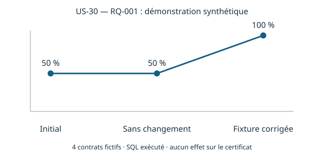

# S5 — Certificat, publication et gouvernance

G02 · lot `L-2026-10-01` · ingénieure qualité Iliana, Data Steward Firdaouss, Data Owner Ruth, rédaction Maria Camila.

## 1. Historique et évolution (US-29/30)

Chaque mesure conserve la règle, la table, le lot, la couche, le nombre de lignes testées, les échecs et la date. La dernière mesure est retenue par identifiant, même si deux exécutions ont le même horodatage. Pour une règle et une couche, les taux du tableau sont pondérés par les lignes testées. Les règles différentes restent séparées.

| Règle | Bronze | Silver | Gold |
|---|---|---|---|
| RQ-001 | 99,20 % | 100,00 % | 100,00 % |
| RQ-002 | 98,62 % | 98,60 % | 100,00 % |
| RQ-003 | 88,00 % | 88,05 % | 89,26 % |
| RQ-004 | 79,30 % | 99,28 % | 100,00 % |
| RQ-005 | 98,91 % | 100,00 % | 100,00 % |
| RQ-006 | 98,41 % | 99,49 % | 99,53 % |
| RQ-007 | 97,82 % | 100,00 % | 100,00 % |
| RQ-008 | 98,81 % | 98,81 % | 100,00 % |
| RQ-009 | 99,80 % | 100,00 % | 100,00 % |
| RQ-010 | 99,40 % | 100,00 % | 100,00 % |
| RQ-011 | 99,80 % | 99,80 % | 100,00 % |
| RQ-012 | 99,00 % | 98,59 % | 100,00 % |
| RQ-013 | 99,50 % | 99,05 % | 100,00 % |
| RQ-014 | 87,90 % | 100,00 % | 100,00 % |
| RQ-015 | 97,71 % | 100,00 % | 100,00 % |
| RQ-016 | 98,09 % | 97,65 % | 96,75 % |
| RQ-017 | 98,90 % | 98,30 % | 100,00 % |
| RQ-018 | 100,00 % | 100,00 % | 100,00 % |
| RQ-019 | 85,97 % | 85,99 % | 100,00 % |
| RQ-020 | 100,00 % | 100,00 % | 100,00 % |
| RQ-021 | 100,00 % | Non applicable / non mesurée ici | Non applicable / non mesurée ici |
| RQ-022 | 100,00 % | Non applicable / non mesurée ici | Non applicable / non mesurée ici |
| RQ-023 | Non applicable / non mesurée ici | 100,00 % | 100,00 % |
| RQ-024 | Non applicable / non mesurée ici | 100,00 % | Non applicable / non mesurée ici |

« Non applicable / non mesurée ici » signifie qu’aucun taux de ce couple ne figure dans l’export, et ne vaut jamais 100 %. RQ-021/022 concernent Bronze ; RQ-024 la conservation Silver ; RQ-025 la réconciliation CRM après publication. Les règles de porte G ne sont pas toutes des obligations sur Bronze.

Source : `reports/S5_export_steward.json`, avec populations détaillées dans sa matrice et sa couverture. Notebook réexécutable : `notebooks/S5_data_steward.ipynb`. Courbe : `reports/S5_US30_courbe.png`. Une variation de taux peut résulter d’un changement de population : la complétude du téléphone s’améliore (88,00 → 88,05 → 89,26 %) mais reste sous 98 % ; RQ-016 final reste à 96,75 % après exclusions de contrats et ne doit pas être masqué par une moyenne de dimension.

## 2. Certificat (US-31)

| Élément | Valeur |
|---|---|
| Certificat | `S5-d7c760617b538e9240c8541a4f7` |
| Lot | `L-2026-10-01` |
| Décision Python et SQL | GO |
| Couverture | 59 contrôles conformes sur 59 attendus, couvrant 18 règles sur B/S/G |
| Empreinte Gold | `a62b0b820e96225b76b20fa7aa0f5b3d4b84841a1c7770801e4e7fcb3ddd1667` |
| Approbation enregistrée | Ruth, Data Owner, 12/11/2026 |

Requête : `sql/S5_decision.sql`. Preuves : `reports/S5_certificat_final.json`, `reports/S5_VALIDATION_DATA_OWNER.json`, `reports/S5_preuves_finales.json`. Les avertissements sous seuil ne sont pas des règles bloquantes manquantes ; les 377 CLI exclus ne font pas partie du contenu autorisé.

Le NO_GO du lot initial est conservé dans les preuves antérieures ; les scénarios dégradés, absence de mesure et absence de décision Owner sont testés dans `pipelines/s5_tests.py`. **RQ-025 est contrôlée après copie, avant validation de la transaction, puis vérifiée après commit**, séparément des 18 règles préalables au certificat.

## 3. Publication (US-32)

Exécuteur : `pipelines/s5_engineering.py`, notebook `notebooks/S5_g02.ipynb`.

| Scénario | Comportement | Preuve |
|---|---|---|
| Sans certificat | Refus, cible inchangée | `reports/S5_refus_nominal.json` |
| Certificat NO_GO | Refus, cible inchangée | même rapport |
| Gold altéré après certificat | Refus | `reports/S5_tests.json`, jeu de test isolé |
| GO et Gold intact | Copie et RQ-025 dans la transaction | `reports/S5_publication_reelle.json` |
| Lot déjà publié | Vérification du certificat, contenu, journal et intégrité, zéro écriture | `pipelines/audit_final.py` et `notebooks/S5_g02.ipynb` |

| Gold → CRM | Lignes Gold | Lignes cible | Écart | Empreintes identiques |
|---|---|---|---|---|
| client_unique → client | 120 673 | 120 673 | 0 | Oui |
| contrat_certifie → contrat | 95 822 | 95 822 | 0 | Oui |
| sinistre_certifie → sinistre | 88 824 | 88 824 | 0 | Oui |

La transaction englobe les trois tables, le journal et RQ-025. Une panne injectée entre tables produit un rollback intégral sur jeu de test contenant déjà des données ; les tests de rejeu ne créent aucun doublon de données. Les traces de vérification sont enregistrées sous `reports/executions/` afin de conserver les preuves de la publication.

## 4. Catalogue et décisions (US-34)

`catalogue/gold_client_unique.md` et `catalogue/catalogue.yml` : Owner Ruth, Data Steward Firdaouss, définition CD-001, règles RQ et lineage CRM/CIF → Bronze → Silver → xref → Gold. Le statut dépend des contrats certifiés ; 1 569 dossiers A_REVOIR ne deviennent pas automatiquement prospects. Journal : D-21 à D-27 pour S5, dont l’approbation finale D-27. Les décisions sont datées dans le journal.

## 5. Bilan et réserves

- [x] NO_GO et refus démontrés ; GO nominal approuvé et publié.
- [x] Comptages et empreintes Gold/CRM identiques sur trois tables.
- [x] Rejeu en lecture seule, chemin portable et contrôle du contenu.
- [x] Rôles, catalogue et lineage renseignés.

Réserves à suivre : 377 CLI hors publication, 23 consolidations à confirmer, 1 569 statuts à revoir et 5 190 téléphones absents. Firdaouss, Data Steward, instruit les identités ; Ruth, Data Owner, arbitre les cas sans preuve. Le dossier fixe une échéance au 20/12/2026 pour les revues d’identité. Les temps de traitement ne sont pas disponibles. L’orchestration US-33 n’a pas été retenue.

## 6. Preuve SQL et évolution des mesures

La ligne SQL du certificat est conservée dans `preuves/S5_certificat_ligne_sql.json` : GO, approbation Ruth, 59 contrôles attendus et conformes.

Un exemple sur quatre contrats fictifs illustre un plateau puis une progression : le même contrôle SQL RQ-001 donne deux fois 2 échecs sur 4, soit 50 %, puis 0 échec après correction de deux dates, soit 100 %. Cet exemple est séparé des mesures du lot certifié. Commande : `python3 scripts/demo_us30.py --output reports/executions/conformite_prof_20261115/us30_demo.json --svg reports/executions/conformite_prof_20261115/us30_demo.svg`.

## 7. Catalogue et contrôles Gold

Le catalogue se lance avec `streamlit run catalogue/app.py --server.port 8502`. Ses cinq fiches viennent de `catalogue/catalogue.yml` et présentent définitions, responsables, règles et parcours des données. `tests/test_catalogue.py` vérifie l’interface et les métadonnées. Les huit suites GE Gold sont dans `reports/ge/gold/expectations/`, avec les résultats dans `reports/S2_execution_gold.json`. Leur vérification utilise un historique séparé de celui du certificat.